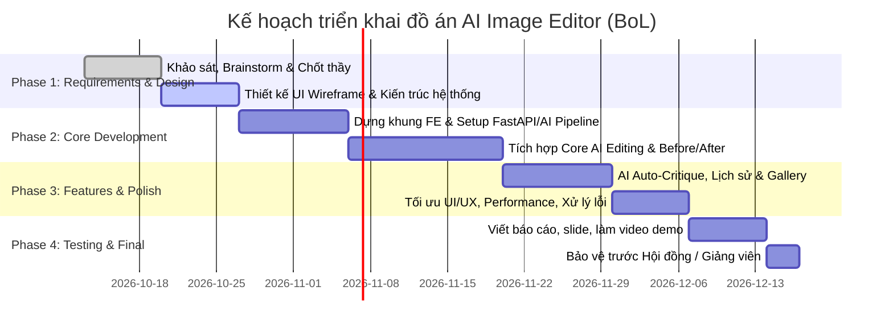

# ĐẶC TẢ YÊU CẦU DỰ ÁN (PROJECT REQUIREMENTS SPECIFICATION)

**Tên dự án (Dự kiến):** PixAI - AI Critique-Guided Image Editor
**Mô hình nhóm:** 1 - 2 thành viên (Đồ án môn học / Capstone)
**Ngày lập:** 13/10/2026
**Trạng thái:** DRAFT (Đang brainstorming & chuẩn bị duyệt Giảng viên)

---

## 1. TỔNG QUAN DỰ ÁN (PROJECT OVERVIEW)

### 1.1. Bối cảnh & Vấn đề thực tế (Problem Statement)

- **Vấn đề:** Hiện nay, việc chỉnh sửa ảnh bằng AI (như Midjourney, Inpainting, DALL-E) thường đòi hỏi người dùng phải biết viết prompt kỹ thuật (prompt engineering phức tạp) hoặc phải dùng cọ vẽ mask thủ công rất mất thời gian.
- **Nhu cầu:** Người dùng phổ thông, nhà sáng tạo nội dung hoặc nhiếp ảnh gia nghiệp dư thường chỉ có thể nhận xét bằng ngôn ngữ tự nhiên dạng phản biện / góp ý (critique) như: *"Vùng mặt hơi tối, hãy làm sáng tự nhiên và xóa người đi bộ đằng sau"*, *"Tông màu quá ấm, hãy đổi sang tone lạnh vintage và tăng độ tương phản"*.
- **Giải pháp của dự án:** Xây dựng một ứng dụng web (**AI Critique-Guided Image Editor**) cho phép:
  - **Input:** Ảnh gốc của người dùng + Nhận xét / Critique (văn bản tự nhiên hoặc chọn từ bộ gợi ý AI).
  - **AI Engine:** Phân tích critique -> chuyển hóa thành các chỉ thị chỉnh sửa cục bộ/toàn cục (Inpainting, Instruct-Pix2Pix, Image-to-Image hoặc ControlNet).
  - **Output:** Ảnh đã chỉnh sửa đúng theo critique, kèm giải trình thay đổi và tính năng so sánh trực quan (Before / After).

---

## 2. MỤC TIÊU SỬ DỤNG (TARGET USERS & USE CASES)

### 2.1. Đối tượng sử dụng chính (Target Audience)

1. **Người dùng mạng xã hội / Cá nhân:** Cần tút lại ảnh cá nhân, ảnh du lịch nhanh chóng dựa trên nhận xét tự nhiên mà không cần biết dùng Photoshop.
2. **Content Creator / Marketer:** Chỉnh sửa ảnh sản phẩm, banner dựa trên phản hồi của sếp hoặc khách hàng (feedback iteration).
3. **Nhiếp ảnh gia nghiệp dư:** Cải thiện bố cục, ánh sáng, màu sắc thông qua đánh giá phân tích chất lượng ảnh từ AI.

### 2.2. Kịch bản sử dụng điển hình (Core User Stories)

- **Story 1 (Chỉnh sửa theo ý muốn):** Người dùng tải ảnh lên -> Nhập critique: *"Xóa chiếc xe máy đỗ bên góc phải và làm nền mờ bokeh"* -> Nhận lại ảnh kết quả trong < 15 giây.
- **Story 2 (AI tự đề xuất critique):** Người dùng tải ảnh lên nhưng chưa biết sửa gì -> Bấm *"AI Audit / Review ảnh"* -> AI phân tích và đưa ra 3 critique gợi ý (VD: Cân bằng trắng chưa tốt, chủ thể thiếu sáng) -> Người dùng chọn 1 critique để áp dụng tự động.
- **Story 3 (Chỉnh sửa lặp - Multi-turn iteration):** Sau khi sửa xong lần 1, người dùng tiếp tục critique: *"Tốt rồi, nhưng tăng sáng thêm một chút nữa"* -> Giữ nguyên mạch chỉnh sửa theo phiên làm việc.

---

## 3. QUY MÔ DỰ ÁN & DANH SÁCH CHỨC NĂNG (SCOPE & ESTIMATION)

> **Chiến lược cho nhóm 1-2 người:** Tập trung vào chất lượng trải nghiệm Core MVP, không dàn trải làm quá nhiều tính năng râu ria. Tổng số tính năng dự kiến: **10 - 12 chức năng**, chia làm 3 nhóm:

### 3.1. Nhóm Chức năng Cốt lõi 

1. **F01 - Tải & Quản lý Canvas ảnh:** Upload ảnh (hỗ trợ JPG, PNG, WebP), xem preview độ phân giải cao, zoom/pan.
2. **F02 - Nhập Critique & Chỉ thị:** Ô nhập văn bản hỗ trợ tiếng Việt / tiếng Anh, độ dài tự do.
3. **F03 - AI Critique-to-Edit Pipeline:**
   - LLM Parser (GPT-4o mini / Gemini 1.5 Flash): Đọc critique + phân tích vị trí cần sửa, tác vụ cần làm (Inpaint / Color grade / Style transfer / Object remove).
   - Image Editing Model (Replicate / Stable Diffusion Instruct-Pix2Pix / Flux / Inpainting API): Thực thi chỉnh sửa ảnh.
4. **F04 - So sánh Trước & Sau (Before/After Slider):** Thanh trượt trực quan cho phép so sánh ảnh gốc và ảnh đã edit từng pixel.
5. **F05 - Lịch sử chỉnh sửa phiên làm việc (Version History):** Cho phép Undo/Redo, xem lại các mốc chỉnh sửa theo từng vòng critique.
6. **F06 - Xuất ảnh (Export):** Tải về ảnh kết quả với chất lượng gốc, hỗ trợ định dạng PNG/JPG.

### 3.2. Nhóm Chức năng Nâng cao 

7. **F07 - AI Auto-Critique (Đánh giá ảnh tự động):** Multimodal AI tự động phân tích ảnh và đưa ra danh sách nhận xét về bố cục, màu sắc, ánh sáng.
8. **F08 - Preset Critique Quick Actions:** Các nút bấm nhanh: *Làm sáng chân dung, Xóa vật thể thừa, Đổi tone phim, Tăng nét chi tiết*.
9. **F09 - Multi-turn Conversation (Hội thoại lặp):** Chat trực tiếp với AI để chỉnh sửa nhiều lượt liên tiếp trên cùng một bức ảnh.

### 3.3. Nhóm Chức năng Quản lý 

10. **F10 - Authentication (Tùy chọn nhẹ):** Đăng nhập Google / Email để lưu bộ sưu tập ảnh đã sửa (dùng Supabase Auth hoặc Clerk).
11. **F11 - Thư viện Gallery cá nhân:** Xem lại danh sách ảnh đã từng chỉnh sửa và các critique đã dùng.
12. **F12 - Rate Limiting & Error Handling:** Xử lý timeout, thông báo khi ảnh lỗi hoặc prompt vi phạm chính sách an toàn.

---

## 4. TƯ VẤN TECH STACK (CÔNG NGHỆ ĐỀ XUẤT)

Dựa trên quy mô nhóm **1 - 2 người (1 Full-Stack + 1 AI)** và yêu cầu **đồ án môn học**, dưới đây là **3 phương án kiến trúc** được so sánh chi tiết:

### Phương án A (Khuyên dùng nhất - Kiến trúc dịch vụ phân tách: Next.js + FastAPI + Cloud AI APIs):
- **Frontend & Web Server:** **Next.js 14+ (App Router) + React + Tailwind CSS**
  - *Lý do:* UI hiện đại, hỗ trợ SSR, thư viện phong phú (Before/After slider, React-cropper), quản lý session và routing dễ dàng.
- **AI Backend Service:** **Python (FastAPI)**
  - *Lý do:* Tách riêng thành một microservice chuyên biệt cho bạn AI. Python là ngôn ngữ tiêu chuẩn cho AI/Computer Vision (Pillow, OpenCV). FastAPI có hiệu năng cao, hỗ trợ Async/Streaming và tài liệu Swagger tự động.
- **Mô hình AI (Cloud APIs):**
  - *Critique Parsing:* **Google Gemini 1.5 Flash API** (cực nhanh, chi phí miễn phí/siêu rẻ, hiểu ảnh đa phương thức rất tốt).
  - *Image Editing:* **Replicate API / Hugging Face Inference** (chạy InstructPix2Pix, SDXL Inpainting hoặc Flux Fill trên cloud, không yêu cầu máy tính có card đồ họa GPU rời).
- **Database & Storage:** **Supabase (PostgreSQL + Cloud Bucket Storage)**
  - *Lý do:* Cung cấp sẵn cơ sở dữ liệu, kho lưu trữ ảnh (Storage bucket), và Authentication. Miễn phí gói Free-tier cho đồ án sinh viên.
- **Đánh giá:** Rất tối ưu cho việc chia việc: Bạn Full-stack làm repo Web, bạn AI làm repo FastAPI, hai bạn chỉ cần thống nhất 1 chuẩn REST API để kết nối.

---

### Phương án B (Kiến trúc Monolith Tinh gọn: 100% Full-Stack TypeScript + Serverless AI SDK):
- **Toàn bộ hệ thống:** **Next.js 14+ / Node.js + TypeScript (Single Monorepo)**
  - *Lý do:* Gộp toàn bộ Frontend và Backend vào trong cùng 1 project Next.js. Gọi trực tiếp các AI Cloud SDK (Vercel AI SDK, Google Generative AI SDK, Replicate SDK) ngay tại Next.js Server Actions / Route Handlers mà không cần dựng riêng server Python.
- **Xử lý ảnh cơ bản:** Thư viện **Sharp** (Node.js) để resize, nén ảnh, xử lý metadata EXIF.
- **Database & Storage:** **Supabase** hoặc **PostgreSQL + Prisma ORM + Cloudflare R2 / AWS S3**.
- **Đánh giá:**
  - *Ưu điểm:* Cực kỳ tinh gọn, quản lý trong 1 repository duy nhất, triển khai (Deploy) 1-click lên Vercel trong 5 phút, không tốn tài nguyên server.
  - *Nhược điểm:* Thành viên phụ trách AI phải code bằng TypeScript/Node.js thay vì Python quen thuộc; khó áp dụng các thư viện AI/CV chuyên sâu của hệ sinh thái Python.

---

### Phương án C (Kiến trúc Tự chủ / On-premise AI: Web Full-Stack + Local GPU / ComfyUI / Stable Diffusion):
- **Frontend:** **React (Vite) + Tailwind CSS** hoặc **Next.js**.
- **Backend & AI Engine:** **Python FastAPI** chạy trực tiếp trên máy trạm của nhóm có gắn card đồ họa rời (**NVIDIA RTX 3060/4060 VRAM $\ge$ 8GB**).
- **Mô hình AI (Local Models):**
  - Chạy mô hình mã nguồn mở cục bộ thông qua **ComfyUI API** hoặc thư viện **Diffusers (Hugging Face)** kết hợp **Ollama (LLaVA / Phi-3-vision)** để giải nghĩa critique.
- **Database & Storage:** **PostgreSQL / SQLite** + Lưu trữ file trực tiếp trên ổ cứng Local Disk.
- **Đánh giá:**
  - *Ưu điểm:* 100% miễn phí, không phụ thuộc internet khi demo (tránh rủi ro rớt mạng khi chấm thi), chứng minh được năng lực làm chủ và triển khai mô hình AI cục bộ cực kỳ thuyết phục trước Hội đồng.
  - *Nhược điểm:* Đòi hỏi máy tính cấu hình mạnh; thời gian cài đặt môi trường CUDA/PyTorch phức tạp; khó public website ra internet cho người ngoài truy cập (phải dùng Ngrok hoặc Cloudflare Tunnel).

---

### Bảng so sánh 3 phương án Tech Stack:

| Tiêu chí so sánh | Phương án A (Next.js + FastAPI + Cloud AI) | Phương án B (100% TypeScript Monolith) | Phương án C (Full-Stack + Local GPU AI) |
| :--- | :---: | :---: | :---: |
| **Mức độ khuyên dùng** | ⭐⭐⭐⭐⭐ **(Khuyên dùng)** | ⭐⭐⭐⭐ | ⭐⭐⭐ |
| **Phù hợp phân chia (1 Full-stack + 1 AI)** | **Rất tốt** (2 repo/service độc lập) | Kém (Bạn AI phải code TS) | **Rất tốt** (Bạn AI làm chủ máy GPU) |
| **Tốc độ hoàn thiện đồ án** | Nhanh (2 – 3 tuần có MVP) | Rất nhanh (1 – 2 tuần) | Trung bình (Tốn thời gian setup CUDA) |
| **Chi phí hạ tầng** | 0đ – rất thấp (Tận dụng Free tier) | 0đ (Free tier Vercel & Supabase) | 0đ (Dùng điện và phần cứng máy cá nhân) |
| **Yêu cầu phần cứng máy tính** | Máy tính văn phòng bình thường | Máy tính văn phòng bình thường | Bắt buộc có GPU NVIDIA VRAM $\ge$ 8GB |
| **Khả năng Deploy Web công khai** | Dễ dàng (Vercel + Render/Railway) | Cực dễ (1-click Vercel) | Phức tạp (Cần IP tĩnh hoặc Tunnel) |

---

### 4.1. Phân tích độ khó chuyên sâu theo từng tầng kỹ thuật (Technical Complexity Analysis)

#### 1. Tầng Trải nghiệm Canvas & Đồ họa Client-Side (Frontend / Full-Stack)
- **Độ phức tạp:** `5.0 / 10`
- **Thách thức kỹ thuật:**
  - **Xử lý tệp ảnh lớn (4K/8K, >15MB):** Việc tải và vẽ trực tiếp ảnh độ phân giải cao lên HTML5 Canvas trên trình duyệt có thể gây sụt giảm khung hình nghiêm trọng (FPS drop), đơ giao diện hoặc gây lỗi tràn bộ nhớ (Out-of-memory crash trên trình duyệt di động).
  - **Đồng bộ hóa Before/After Slider:** Thanh trượt phải khớp chính xác từng điểm ảnh giữa ảnh gốc và ảnh đã sửa với mọi tỉ lệ khung hình (Aspect Ratio), không được xảy ra hiện tượng co giãn méo ảnh (Aspect Ratio Distortion).
- **Giải pháp công nghệ:**
  - **Client-side Downsampling:** Trình duyệt tự tạo phiên bản preview tối ưu (giới hạn cạnh dài nhất tối đa 2048px) để render và thao tác mượt mà trên Canvas; tệp ảnh gốc chất lượng cao được lưu trữ riêng để phục vụ tải về (Export).
  - **Quản lý vòng đời bộ nhớ:** Sử dụng `URL.revokeObjectURL()` ngay khi ảnh cũ bị thay thế hoặc component bị hủy (unmount) để triệt tiêu nguy cơ rò rỉ bộ nhớ (Memory Leaks).
  - **Tối ưu phần cứng CSS:** Kích hoạt tăng tốc phần cứng bằng thuộc tính `will-change: transform` và `transform: translate3d(0,0,0)` giúp thanh trượt Before/After luôn đạt tốc độ khung hình 60 FPS ổn định.

#### 2. Tầng Giao tiếp Mạng & Xử lý Bất đồng bộ (Network & Async Architecture)
- **Độ phức tạp:** `6.5 / 10`
- **Thách thức kỹ thuật:**
  - **Hiện tượng Gateway Timeout (HTTP 504):** Các mô hình Diffusion / Inpainting thường mất từ **10 – 25 giây** để hoàn thành một tác vụ sinh ảnh. Trong khi đó, các dịch vụ Serverless (như Vercel Free-tier) giới hạn thời gian phản hồi tối đa là **10 – 15 giây**. Nếu sử dụng mô hình gọi HTTP REST đồng bộ truyền thống, kết nối chắc chắn sẽ bị ngắt giữa chừng.
  - **Trải nghiệm chờ đợi của người dùng:** Nếu không có phản hồi trạng thái rõ ràng, người dùng sẽ lầm tưởng hệ thống bị treo và nhấn nút gửi nhiều lần (Spam Request), gây nghẽn hàng đợi và lãng phí hạn ngạch API.
- **Giải pháp công nghệ:**
  - **Kiến trúc Bất đồng bộ (Asynchronous Job Polling / SSE):**
    - Client gửi ảnh và nhận xét $\rightarrow$ Backend khởi tạo tác vụ, lập tức trả về mã `task_id` kèm trạng thái `QUEUED` trong vòng < 300ms.
    - Client định kỳ kiểm tra trạng thái (`Polling` mỗi 2 giây) hoặc lắng nghe sự kiện qua **Server-Sent Events (SSE)** từ FastAPI.
  - **Optimistic Stage Progress Bar:** Thiết kế thanh tiến trình chi tiết trên giao diện hiển thị từng pha xử lý cụ thể: *(1. Đang đọc hiểu critique $\rightarrow$ 2. Đang phân vùng ảnh $\rightarrow$ 3. Đang khuếch tán sinh ảnh $\rightarrow$ 4. Đang hoàn tất)*, kèm hiệu ứng chuyển động skeleton giúp người dùng an tâm trong thời gian chờ.

#### 3. Tầng Thuật toán AI, Hiểu ngữ nghĩa & Bảo toàn tính nhất quán (AI Fidelity & Semantic Drift)
- **Độ phức tạp:** `8.5 / 10` *(Thách thức cốt lõi quyết định chất lượng và điểm số của đề tài)*
- **Thách thức kỹ thuật:**
  - **Trôi dạt ngữ nghĩa (Semantic Drift & Identity Loss):** Các mô hình Diffusion có xu hướng tái tạo lại toàn bộ bức ảnh thay vì chỉ sửa vùng cần thiết. Ví dụ: Người dùng yêu cầu *"Xóa người đi bộ đằng sau"* hoặc *"Làm sáng áo"*, nhưng mô hình lại vẽ lại luôn khuôn mặt của nhân vật chính, làm mất hoàn toàn đường nét và nhân dạng ban đầu.
  - **Độ mơ hồ của ngôn ngữ tự nhiên (Critique Ambiguity):** Người dùng thường góp ý rất ngắn gọn và cảm tính (*"cho nó nghệ hơn"*, *"chỗ này hơi tối"*), mô hình AI sinh ảnh thuần túy không thể tự nội suy được ý định này.
- **Giải pháp công nghệ:**
  - **Quy trình điều phối đa mô hình hai giai đoạn (Two-Stage AI Pipeline):**
    - **Giai đoạn 1 (Hiểu ý đồ & Định vị không gian - Perception & Spatial Reasoning):** Dùng Multimodal LLM (Gemini 1.5 Flash) đọc ảnh gốc kết hợp critique, đóng vai trò như một chuyên gia đồ họa: trích xuất tác vụ chính xác (Xóa vật thể / Chỉnh sáng / Đổi màu), tạo tọa độ vùng can thiệp (Bounding Box), đồng thời sinh ra bộ *Targeted Prompt* và *Strict Negative Prompt* bảo vệ chủ thể (`preserve subject identity, keep facial structure untouched, seamless blend`).
    - **Giai đoạn 2 (Thực thi cục bộ - Inpainting Execution):** Áp dụng kỹ thuật **Masked Inpainting** chỉ thay thế các pixel bên trong vùng cần sửa, giữ nguyên 100% các pixel nền tảng bên ngoài. Với tác vụ đổi tone màu toàn bức, kiểm soát tham số độ nhiễu `denoising_strength` ở mức an toàn ($0.25 - 0.45$) để không phá vỡ cấu trúc gốc.

#### 4. Tầng Dữ liệu, Chi phí & An toàn nội dung (Data, Cost & Safety)
- **Độ phức tạp:** `5.0 / 10`
- **Thách thức kỹ thuật:**
  - **Nguy cơ cạn kiệt Credit & Giới hạn tần suất (Rate Limit):** Trong quá trình lập trình và thử nghiệm, gọi API liên tục có thể làm tiêu hao nhanh chóng ngân sách hoặc chạm ngưỡng giới hạn (HTTP 429 Too Many Requests).
  - **Tràn dung lượng Cloud Storage:** Lưu trữ ảnh gốc và ảnh kết quả không kiểm soát sẽ nhanh chóng làm đầy bộ nhớ miễn phí của Supabase (1GB).
  - **Nội dung nhạy cảm (Content Safety / NSFW):** Ảnh người dùng tải lên có thể vi phạm tiêu chuẩn cộng đồng dẫn đến việc API Key bị nhà cung cấp khóa tài khoản.
- **Giải pháp công nghệ:**
  - **Chế độ Mock AI Service cho Môi trường Phát triển:** Xây dựng cờ cấu hình `USE_MOCK_AI=true` trong Backend, trả về ảnh mẫu giả lập sau 2.5 giây để bạn Full-Stack thoải mái code và test giao diện mà không tốn một lượt gọi API thật nào.
  - **Chính sách tự động dọn dẹp (Storage TTL & Auto Cleanup):** Thiết lập lịch trình tự động xóa các ảnh tạm của phiên làm việc sau 48 giờ; chỉ những ảnh được người dùng bấm "Lưu vào Thư viện" mới được lưu trữ vĩnh viễn.
  - **Kiểm duyệt an toàn nội dung (Safety Guardrails):** Tận dụng tính năng Safety Settings có sẵn trong Gemini API để từ chối các prompt và hình ảnh vi phạm chính sách trước khi gửi vào pipeline sinh ảnh.

---

### 4.2. Ma trận Đánh giá Rủi ro & Biện pháp Giảm thiểu (Project Risk Matrix)

| STT | Rủi ro nhận diện | Khả năng xảy ra | Mức độ ảnh hưởng | Cấp độ rủi ro | Biện pháp phòng ngừa & Giảm thiểu |
| :---: | :--- | :---: | :---: | :---: | :--- |
| **R01** | **Serverless Timeout (Lỗi HTTP 504 khi chờ AI sinh ảnh)** | **Cao** | **Nghiêm trọng** | 🔴 **CAO** | Chuyển sang kiến trúc Polling bất đồng bộ (`task_id`) hoặc Server-Sent Events (SSE). |
| **R02** | **AI làm biến dạng nhân vật chính (Identity/Semantic Drift)** | **Cao** | **Chí mạng** | 🔴 **CAO** | Áp dụng Two-stage Pipeline: Dùng Multimodal LLM sinh Mask & Prompt chuẩn trước khi Inpaint. Giới hạn `denoising_strength`. |
| **R03** | **Cạn kiệt Credit / API Provider bị lỗi đúng ngày bảo vệ** | **Trung bình** | **Chí mạng** | 🔴 **CAO** | Bật chế độ Cache kết quả, chuẩn bị tài khoản API dự phòng và chuẩn bị sẵn Kịch bản Demo Offline (Fail-safe). |
| **R04** | **Tràn bộ nhớ trình duyệt khi xử lý nhiều ảnh lớn liên tục** | **Trung bình** | **Vừa** | 🟡 **TRUNG BÌNH** | Tự động downscale ảnh preview trên client ($< 2048px$), giải phóng Blob URL bằng `revokeObjectURL()`. |
| **R05** | **Bị khóa API Key do người dùng upload ảnh nhạy cảm / vi phạm** | **Thấp** | **Nghiêm trọng** | 🟡 **TRUNG BÌNH** | Kích hoạt bộ lọc Gemini Safety Settings ở tầng Gateway để chặn ảnh và prompt vi phạm từ đầu. |

---

### 4.3. Kế hoạch Dự phòng Khẩn cấp cho Ngày Báo cáo / Bảo vệ Đồ án (Demo Day Fail-Safe Plan)

Để đảm bảo buổi demo trực tiếp trước Giảng viên và Hội đồng diễn ra **100% trơn tru, không gặp sự cố kỹ thuật ngoài ý muốn**, nhóm áp dụng bộ 3 nguyên tắc phòng vệ:

1. **Kịch bản Mạng Internet tại trường bị chập chờn / Mất kết nối:**
   - Chuẩn bị sẵn bộ phát 4G/5G cá nhân dự phòng.
   - Toàn bộ source code Backend và Frontend đều có thể chạy được ở chế độ `localhost` trên máy tính cá nhân mà không bắt buộc phải phụ thuộc vào link deploy đám mây.
2. **Kịch bản Nhà cung cấp API AI (Replicate / Google) bị bảo trì hoặc quá tải:**
   - **Cơ chế Local Smart Cache:** Hệ thống tự động lưu cache kết quả của 5 cặp ảnh demo mẫu (Ví dụ: 1 ảnh chân dung làm sáng mặt, 1 ảnh du lịch xóa người thừa, 1 ảnh phong cảnh đổi tone màu). Nếu hệ thống phát hiện API ngoài bị timeout quá 25 giây, backend sẽ tự động fallback trả về kết quả đã cache để luồng demo không bị gián đoạn.
3. **Kịch bản Video / Ảnh minh chứng độc lập:**
   - Quay sẵn một video demo chất lượng cao 4K ghi lại toàn bộ thao tác thực tế từ lúc upload ảnh, gõ critique cho đến khi xuất ảnh hoàn tất để sẵn sàng trình chiếu nếu thiết bị trình chiếu tại phòng thi gặp sự cố.

---

## 5. KẾ HOẠCH DEADLINE & CÁC GIAI ĐOẠN (PROJECT TIMELINE)

Giả định chu kỳ đồ án chuẩn **8 - 10 tuần** (có thể điều chỉnh theo lịch của trường bạn):

---

## 6. PHÂN CÔNG CÔNG VIỆC THEO TỪNG PHASE (TEAM 2 THÀNH VIÊN)

| Giai đoạn (Phase)                                    | Thành viên A: Full-Stack Engineer (Web & System)                                                                                                                                         | Thành viên B: AI Engineer (AI Core & Pipeline)                                                                                                                                                                | Kết quả bàn giao (Deliverable)                                                                                         |
| :----------------------------------------------------- | :----------------------------------------------------------------------------------------------------------------------------------------------------------------------------------------- | :-------------------------------------------------------------------------------------------------------------------------------------------------------------------------------------------------------------- | :------------------------------------------------------------------------------------------------------------------------ |
| **Phase 1: Req & Design***(Tuần 1 - 2)*       | - Thiết kế Wireframe/UI Flow (Figma)- Dựng kiến trúc Full-stack (Next.js + DB/Storage Supabase)- Thiết kế Database Schema, Auth flow & API Contract                                 | - Khảo sát các mô hình AI (InstructPix2Pix, Gemini 1.5 Flash, SDXL)- Xây dựng cấu trúc prompt/parser cho critique- Viết báo cáo kỹ thuật phần AI & soạn Biên bản Phase 1                      | - Wireframe UI + DB Schema- AI Architecture Spec & Test script PoC- Biên bản chốt với Thầy                           |
| **Phase 2: Core MVP***(Tuần 3 - 5)*           | - Xây dựng toàn bộ Web Frontend (Canvas, Upload, Before/After Slider)- Viết Backend API xử lý ảnh, lưu trữ Supabase Storage- Tích hợp gọi sang AI Service của Thành viên B | - Xây dựng AI Pipeline hoàn chỉnh (FastAPI / AI service)- Viết bộ phân tích critique bằng Multimodal LLM (Gemini)- Kết nối model chỉnh sửa ảnh (Replicate/SDXL Inpaint)                           | - Hệ thống web chạy thông luồng end-to-end:Upload ảnh + critique -> AI xử lý -> hiển thị kết quả Before/After |
| **Phase 3: Enhancements***(Tuần 6 - 7)*       | - Làm tính năng Multi-turn Session, History (Undo/Redo)- Hoàn thiện UI Preset buttons, Gallery & Download- Tối ưu hóa UI/UX, responsive, xử lý trạng thái chờ/loading         | - Xây dựng tính năng AI Auto-Critique (tự đánh giá ảnh)- Tối ưu prompt, xử lý edge cases (ảnh mờ, prompt không hợp lệ)- Đánh giá chất lượng ảnh (PSNR/SSIM/User study) & đo độ trễ | - Ứng dụng hoàn thiện 100% tính năng nâng cao- Bộ dữ liệu test & kết quả benchmark AI                         |
| **Phase 4: Polish & Báo cáo***(Tuần 8 - 9)* | - Deploy Web lên Vercel / Cloud server- Kiểm thử toàn diện hệ thống (End-to-End Test), fix bug- Quay Video demo sản phẩm thực tế                                                | - Đóng gói tài liệu kỹ thuật AI, cấu hình model- Viết nội dung phần AI & Thực nghiệm trong báo cáo- Hoàn thiện Slide thuyết trình cùng Thành viên A                                      | - Website live hoạt động ổn định- Video demo + Slide + Báo cáo đồ án hoàn chỉnh                              |

---

## 7. CÁC ĐIỂM CẦN HỎI Ý KIẾN THẦY (DISCUSSION POINTS WITH PROFESSOR)

1. **Về việc dùng API bên thứ ba:** Môn học có bắt buộc phải tự train/fine-tune model AI không, hay được phép tích hợp các Foundation Model / Open-source Pretrained Models qua API (như Gemini, Hugging Face, Replicate)?
2. **Quy mô tính năng:** Với nhóm 1-2 người, thầy có yêu cầu thêm tính năng quản trị Admin hay phân quyền phức tạp không?
3. **Tiêu chí đánh giá trọng tâm:** Điểm số môn học sẽ ưu tiên tính thực tiễn và UI/UX của sản phẩm hay độ phức tạp của thuật toán AI pipeline?
